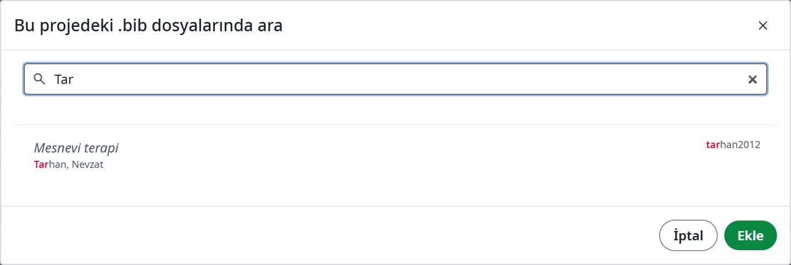
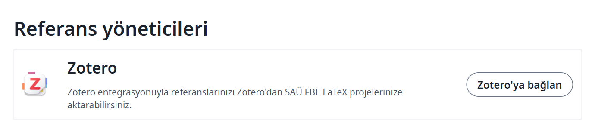

# SAÜ FBE Tez Şablonu + AyakaLeaf Pro

[](https://burhanbarakli.github.io/sau-fbe-ayakaleaf/)

<p align="center"><sub>Şablondan açılan proje: solda <code>tez.tex</code>, sağda LuaLaTeX ile derlenmiş PDF.
<a href="https://burhanbarakli.github.io/sau-fbe-ayakaleaf/">Resimli kurulum ve kullanım kılavuzu</a></sub></p>

Kendi bilgisayarınızda (ya da bölümünüzün sunucusunda) çalışan, **Overleaf benzeri çevrimiçi bir LaTeX
editörü** kurar ve içine **Sakarya Üniversitesi Fen Bilimleri Enstitüsü lisansüstü tez şablonunu** hazır
şablon olarak ekler. Kurulumdan sonra proje listenizde şablonun hazır bir kopyası (**Tezim**) durur: açın,
adını değiştirin ve yazmaya başlayın. Yeni kopyalar için şablon galeride de durur (**Yeni Proje → Diğer şablonlar →
Tezler**). TeX dağıtımı kurmanız gerekmez.

- **Şablonun kendisi (LaTeX, Word karşılaştırması):** <https://github.com/burhanbarakli/sau-fbe-doktora-latex-sablonu>
- **Şablonun resimli kullanım kılavuzu:** <https://burhanbarakli.github.io/sau-fbe-doktora-latex-sablonu/>
- **Bu kurulumun resimli kılavuzu:** <https://burhanbarakli.github.io/sau-fbe-ayakaleaf/>
- **AyakaLeaf Pro:** <https://ayakaleaf-pro.ayaka.space/> (Overleaf Community Edition tabanlı, ücretsiz, AGPL-3.0)

> Bu depo AyakaLeaf'in kendisini içermez; resmi [AyakaLeaf Toolkit](https://github.com/ayaka-notes/toolkit)'ini
> indirir, ayarlar ve şablonu yükler. Overleaf, AyakaLeaf ve SAÜ FBE ile resmi bir bağı yoktur.

## Nasıl çalışır?

```
 Tarayıcı ──► http://localhost:8080
                │
   ┌────────────┴───────────── Docker ──────────────────────────────┐
   │  sharelatex   AyakaLeaf Pro: editör, proje listesi, şablon galerisi │
   │  mongo        kullanıcılar, projeler, şablon kayıtları             │
   │  redis        anlık ortak düzenleme                               │
   │  texlive-full her "Derle"de açılıp kapanan TeX Live 2026 kabı      │
   │               (LuaLaTeX burada çalışır; bilgisayarınıza TeX kurulmaz) │
   └────────────────────────────────────────────────────────────────┘
   Veriler: ~/ayakaleaf-toolkit/data/   Ayarlar: ~/ayakaleaf-toolkit/config/
```

`kur.sh` sırasıyla şunları yapar:

1. İşletim sistemini ve Docker'ı denetler (Docker yoksa Linux/WSL'de kurmayı önerir).
2. AyakaLeaf Toolkit'i `~/ayakaleaf-toolkit` klasörüne indirir ve `bin/init` ile ayar dosyalarını oluşturur.
3. Ayarları yazar: AyakaLeaf Pro imajı, port 8080, Türkçe arayüz, TeX Live 2026 full, korumalı (sandbox)
   derleme, **şablon galerisi** ve "Tezler" kategorisi.
4. `bin/up -d` ile kapları başlatır (ilk seferde imajlar iner).
5. `sablonu-yayinla.py` ile ilk **yönetici hesabını** oluşturur, şablonun son sürümünü GitHub'dan indirir,
   proje olarak yükler, derleyiciyi **LuaLaTeX** yapıp derler ve galeride yayınlar.
6. Yönetici hesabında henüz proje yoksa şablonun bir kopyasını **Tezim** adıyla hazır proje olarak oluşturur.
   Hesapta zaten proje varsa (adı değiştirilmiş olsa bile) yeni kopya eklemez.

## Gereksinimler

| | Windows 10/11 | macOS | Linux (Ubuntu/Debian) |
|---|---|---|---|
| Sanallaştırma | **WSL 2** + Ubuntu (`wsl --install -d Ubuntu`); BIOS'ta sanallaştırma açık | Docker Desktop'ın desteklediği macOS (Apple Silicon veya Intel) | — |
| Docker | **Docker Desktop** (WSL 2 altyapısı, *WSL Integration* açık) **ya da** Ubuntu içinde Docker Engine (`kur.sh` kurabilir) | **Docker Desktop** (Settings → Advanced → *Allow the default Docker socket*) | Docker Engine 25–29 + `docker compose` eklentisi (`kur.sh` kurabilir) |
| Araçlar | Ubuntu içinde: `git curl openssl python3 perl gawk` | Xcode Command Line Tools (`git`, `python3`), [Homebrew](https://brew.sh), `gnu-sed` (`kur.sh` kurar) | `git curl openssl python3 perl gawk` |
| Bellek / CPU | Docker'a en az 4 GB, önerilen **8 GB** ve 4 CPU | Aynı (Docker Desktop → Resources) | Aynı |
| Disk | **50 GB** boş alan (TeX Live full imajı diskte ~29 GB, AyakaLeaf + MongoDB ~4 GB, artı projeleriniz) | Aynı (Docker Desktop disk sınırını da kontrol edin) | Aynı |
| İnternet | Yalnızca kurulumda (imajlar ve şablon indirilir); sonrası çevrimdışı çalışır | Aynı | Aynı |

Bilgisayarınıza MiKTeX/MacTeX, MongoDB ya da Redis kurmanız **gerekmez**; hepsi Docker kaplarında çalışır.

## Kurulum

### Windows

1. **PowerShell'i yönetici olarak** açın:
   ```powershell
   wsl --install -d Ubuntu
   ```
   İstenirse yeniden başlatın. Başlat menüsünden **Ubuntu**'yu açıp Linux kullanıcı adı ve şifresi belirleyin.
2. Docker için iki yoldan birini seçin:
   - **Docker Desktop (önerilen)** ([indir](https://docs.docker.com/desktop/setup/install/windows-install/)): kurun,
     açın, **Settings → Resources → WSL Integration** altında **Ubuntu**'yu açıp *Apply & restart* deyin.
     Docker Desktop açık olduğu sürece site çalışır.
   - **Docker Engine (Ubuntu içinde, ücretsiz, Windows'a bir şey kurmaz):** hiçbir şey kurmayın; `kur.sh` Docker
     bulamazsa kurmayı önerir (Linux şifrenizi sorar). Kurulumdan sonra Ubuntu penceresini kapatıp yeniden açın ve
     `./kur.sh`'ı tekrar çalıştırın. **Dikkat:** bu yolda açık bir Ubuntu penceresi kalmadığında Windows WSL'i
     birkaç saniye sonra kapatır ve site de kapanır; Ubuntu'yu yeniden açınca kaplar kendiliğinden başlar.
     Tez yazarken bir Ubuntu penceresini açık bırakın.
3. **Ubuntu** terminalinde (PowerShell'de değil):
   ```bash
   sudo apt update && sudo apt install -y git curl openssl python3 perl gawk
   cd ~
   git clone https://github.com/burhanbarakli/sau-fbe-ayakaleaf.git
   cd sau-fbe-ayakaleaf
   ./kur.sh
   ```
4. Betik bittiğinde Windows tarayıcınızda <http://localhost:8080> adresini açın.

> Toolkit'i ve verileri `/mnt/c/...` altına değil, Ubuntu'nun ev klasörüne kurun (betik bunu varsayılan olarak yapar).

### macOS

1. [Docker Desktop](https://docs.docker.com/desktop/setup/install/mac-install/)'ı kurup açın. **Settings →
   Resources**'ta en az 4 CPU / 8 GB bellek verin; **Settings → Advanced → Allow the default Docker socket to
   be used** seçeneğini açın.
2. [Homebrew](https://brew.sh) yoksa kurun. Terminal'de:
   ```bash
   cd ~
   git clone https://github.com/burhanbarakli/sau-fbe-ayakaleaf.git
   cd sau-fbe-ayakaleaf
   ./kur.sh
   ```
   (`git` ilk çalıştırmada Command Line Tools kurmayı önerirse kabul edin.)
3. <http://localhost:8080> adresini açın.

### Linux

```bash
sudo apt update && sudo apt install -y git curl openssl python3 perl gawk
git clone https://github.com/burhanbarakli/sau-fbe-ayakaleaf.git
cd sau-fbe-ayakaleaf
./kur.sh
```

### Kurulum sırasında sorulanlar

- **Yönetici e-postası ve şifresi:** AyakaLeaf'e giriş bilgileriniz olur (yalnızca bu kurulumda geçerli;
  şifre en az 8 karakter). Daha önce yönetici oluşturduysanız aynı bilgileri girin.
- **Docker Engine kurulsun mu?** Yalnızca Linux/WSL'de Docker yoksa sorulur.

İlk kurulum, TeX Live imajının boyutu nedeniyle bağlantınıza göre 15–60 dakika sürebilir. Sonraki
başlatmalar saniyeler içinde olur.

## Kullanım

1. <http://localhost:8080> → yönetici e-postanız ve şifrenizle giriş yapın.
2. Proje listesinde **Tezim** hazır durur. Adını değiştirmek için satırın onay kutusunu işaretleyip
   **Daha fazla → Adlandır**'ı seçin (ya da editörde üstteki proje adına tıklayın). Projeye tıklayıp açın;
   derleyici LuaLaTeX olarak ayarlıdır.
3. Başka bir kopya gerekirse (örneğin ikinci bir tez ya da başka bir kullanıcı için): **Yeni Proje → Diğer
   şablonlar → Tezler** ya da <http://localhost:8080/templates/thesis> → **SAÜ FBE Lisansüstü Tez Şablonu** →
   **Şablon Olarak Aç**. Sol taraftaki dosya ağacında:
   - `tez.tex`: tez başlığı, adınız, anabilim dalı, danışman, jüri ve bölüm sırası,
   - `onkisim/`: teşekkür, özet, summary, kısaltmalar, simgeler,
   - `bolumler/`: bölümler, kaynaklar, ekler, özgeçmiş,
   - `sekiller/`: görseller (sürükle-bırak ile yükleyin).
4. **Derle** (Ctrl+S / Ctrl+Enter) ile PDF'i sağda görün; **İndir** ile PDF'i alın.
5. Teslimden önce `tez.tex`'in ilk satırında `notlar` yerine `notsuz` yazın.

> **Arşivlenmiş projeler**'deki "SAÜ FBE Lisansüstü Tez Şablonu" galerinin kaynağıdır; şablon güncellenince
> silinir. Tezinizi onun içine değil, **Tezim**'e (ya da galeriden açtığınız kopyaya) yazın.

Şablondaki her komutun ne yaptığı ve hangi sayfayı değiştirdiği: [şablon kılavuzu](https://burhanbarakli.github.io/sau-fbe-doktora-latex-sablonu/).

### Başka kullanıcılar eklemek

Yönetici olarak sağ üstte **Admin → Kullanıcı yönetimi → Hesap oluştur** ile öğrencileri/danışmanları ekleyin;
projeyi **Paylaş** düğmesiyle birlikte düzenleyebilirsiniz. Hazır **Tezim** projesi yalnızca yönetici hesabına
konur; yeni kullanıcılar kendi kopyalarını galeriden **Şablon Olarak Aç** ile açar. Varsayılan ayar yalnızca bu bilgisayardan erişime
izin verir (`127.0.0.1`). Ağdaki başka bilgisayarların erişmesi için `config/overleaf.rc`'de
`OVERLEAF_LISTEN_IP` ve `config/variables.env`'de `OVERLEAF_SITE_URL` değiştirilmeli, ağ/güvenlik duvarı ve
HTTPS ayarlanmalıdır; bkz. [AyakaLeaf belgeleri](https://ayakaleaf-pro.ayaka.space/on-premises/).

## Kaynaklar, Zotero ve Mendeley

Şablonda kaynakça iki yolla yazılır (ayrıntılar ve örnekler [şablon kılavuzunda](https://burhanbarakli.github.io/sau-fbe-doktora-latex-sablonu/#kaynaklar)):

1. **Elle (varsayılan):** `bolumler/kaynaklar.tex`'e her kaynak için `\kaynak{...}` (APA) ya da
   `\begin{kaynaklistesi} \item ... \end{kaynaklistesi}` (numaralı [1]); metin içi atıflar da elle yazılır:
   `(Baran, 2003)`, `[1]`.
2. **`.bib` dosyasından:** kaynak listesi ve atıflar Zotero, Mendeley ya da JabRef'ten gelen `.bib` dosyasından
   üretilir; sıralama, "ve ark." ve kılavuz biçimi kendiliğinden olur. Projede:
   - `tez.tex`'in başındaki `\input{bib-ayar}` ve `\addbibresource{zotero.bib}` satırlarının `%` işaretini silin
     (numaralı düzen için `\newcommand\kaynakduzeni{numarali}` satırını da açın),
   - `bolumler/kaynaklar.tex`'in içeriğini `\bolumsuz{KAYNAKLAR}` ve `\printbibliography[heading=none]` yapın,
   - metinde `\textcite{anahtar}` → Baran (2003), `\parencite{anahtar}` → (Baran, 2003), numaralı düzende
     `\cite{anahtar}` → [1] yazın ve **Derle**'ye basın (biber kendiliğinden çalışır).

> Projenizde `bib-ayar.tex` yoksa proje bu dosya eklenmeden önceki şablon sürümünden açılmıştır. Dosyayı
> [GitHub'dan](https://github.com/burhanbarakli/sau-fbe-doktora-latex-sablonu/blob/main/sablon/bib-ayar.tex)
> indirip **Yeni Dosya → Yükle** ile ekleyin; galeriyi güncellemek için `./kur.sh --sablon`.

**Kaynak arama:** `\parencite{` (ya da `\cite{`, `\textcite{`) yazıp **Ctrl+Space**'e basın. Açılan
**Bu projedeki .bib dosyalarında ara** penceresinde yazar, başlık ya da anahtarın birkaç harfini yazın ve
**Ekle**'ye basın; anahtar atıfın içine yazılır. Bu özellik ayar gerektirmez.

<a href="docs/img/kaynak_arama.png"></a>

### `.bib` dosyasını projeye almak

| Yol | Ne zaman | Nasıl |
|---|---|---|
| **Zotero bağlantısı** | Kütüphaneniz zotero.org ile eşitleniyorsa | Yönetici bir kez açar (aşağıda). Sonra **Hesap → Hesap Ayarları → Referans yöneticileri → Zotero'ya bağlan**. Projede **Yeni Dosya → Zotero'dan** → dosya adı `zotero.bib`, kütüphane ya da grup seçin → **Oluştur**. Zotero'da değişiklik yaptıktan sonra dosyayı açıp **Yenile**'ye basın. |
| **Mendeley bağlantısı** | Mendeley kullanıyorsanız | Aynı adımlar: **Mendeley'e bağlan**, **Yeni Dosya → Mendeley'dan**. |
| **Zotero + Better BibTeX** | Bağlantı açık değilse ya da çevrimdışı | Bilgisayarınızda Zotero'ya [Better BibTeX](https://retorque.re/zotero-better-bibtex/) kurun, koleksiyonu **Better BibLaTeX** olarak dışa aktarın, `.bib`'i **Yeni Dosya → Yükle** ile ekleyin. Kaynak ekledikçe yeniden yükleyin. |
| **Mendeley / JabRef / EndNote** | Diğer araçlar | BibTeX ya da BibLaTeX olarak dışa aktarıp **Yükle**. |

Bağlantıyla gelen `.bib` editörde **salt okunurdur** ve yalnızca onu ekleyen kişi yenileyebilir; projeyi
paylaştığınız danışman dosyayı görür ama yenileyemez. Bu özellik AyakaLeaf'te henüz beta durumundadır.
"Zotero'dan" seçeneği **Yeni Dosya** penceresinde yalnızca hesabınız bağlandıktan sonra görünür.

<a href="docs/img/zotero_ayar.png"></a>

### Zotero / Mendeley bağlantısını açmak (yönetici, bir kez)

1. **Zotero:** <https://www.zotero.org/oauth/apps> → *Register a new application*. Uygulama türü **Browser**,
   *Callback URL* `http://localhost:8080/user/zotero/oauth/callback` (portu değiştirdiyseniz onu yazın).
   Verilen **Client Key** ve **Client Secret**'ı not edin.
   **Mendeley:** <https://dev.mendeley.com/myapps.html> → yeni uygulama, *Redirect URL*
   `http://localhost:8080/user/mendeley/oauth/callback`, yetkilendirme akışı **Elsevier**. **ID** ve **Secret**'ı not edin.
2. Bu depo klasöründe `kur.sh`'ı anahtarlarla yeniden çalıştırın (mevcut kurulum ve projeler korunur):
   ```bash
   ZOTERO_CLIENT_ID=... ZOTERO_CLIENT_SECRET=... ./kur.sh
   ```
   Mendeley için `MENDELEY_CLIENT_ID=... MENDELEY_CLIENT_SECRET=...` ekleyin; ikisi birlikte verilebilir. Betik
   `config/variables.env`'e `ENABLED_LINKED_FILE_TYPES` (zotero/mendeley eklenir), istemci anahtarlarını ve
   `ZOTERO_CIPHER_PASSWORD` / `MENDELEY_CIPHER_PASSWORD` şifreleme anahtarını yazar ve sunucuyu yeniden başlatır.
   Elle yapmak isterseniz aynı satırları ekleyip `bin/up -d` çalıştırın.

Sunucunun internete açık olması gerekmez: bağlanma tarayıcınız üzerinden olur, sunucu yalnızca zotero.org ve
Mendeley API'sine erişebilmelidir (gerekirse `ZOTERO_PROXY_URL` / `MENDELEY_PROXY_URL`). Ayrıntı: AyakaLeaf
belgeleri, [Zotero](https://ayakaleaf-pro.ayaka.space/on-premises/configuration/overleaf-toolkit/integrations/zotero-integration.md)
ve [Mendeley](https://ayakaleaf-pro.ayaka.space/on-premises/configuration/overleaf-toolkit/integrations/mendeley-integration.md).

### Diğer eklentiler

AyakaLeaf Pro'da kaynak yönetimi dışında da şu özellikler vardır. `kur.sh` bunları ayarlamaz; açmak ya da
yapılandırmak için AyakaLeaf belgelerine bakın:

| Özellik | Ne işe yarar |
|---|---|
| [GitHub / GitLab / Gitea eşitleme](https://ayakaleaf-pro.ayaka.space/on-premises/readme/features-and-copyright.md) | Projeyi bir Git deposuyla iki yönlü eşitler (tezin sürüm geçmişi ve yedeği). |
| [Dropbox eşitleme](https://ayakaleaf-pro.ayaka.space/on-premises/readme/features-and-copyright.md) | Proje dosyalarını Dropbox klasörüyle eşitler. |
| [MCP sunucusu](https://ayakaleaf-pro.ayaka.space/on-premises/configuration/overleaf-toolkit/integrations/mcp-server.md) | Claude Code gibi yapay zekâ araçlarının projeyi okuyup düzenlemesine ve derlemesine izin verir. |
| [Yapay zekâ asistanı](https://ayakaleaf-pro.ayaka.space/on-premises/readme/features-and-copyright.md) | Proje hakkında sohbet ve derleme hatalarını açıklama. |

## Günlük kullanım

Windows'ta önce Docker Desktop'ı açın (Docker Engine yolundaysanız bir Ubuntu penceresi açmanız yeter; kaplar
kendiliğinden başlar), sonra gerekirse Ubuntu/Terminal'de:

| İş | Komut (`cd ~/ayakaleaf-toolkit` içinde) |
|---|---|
| Başlat | `bin/start` |
| Durdur (veriler kalır) | `bin/stop` |
| Ayar değişikliğini uygula | `bin/up -d` |
| Durum | `bin/docker-compose ps` |
| Uygulama günlüğü | `bin/docker-compose logs --tail=100 sharelatex` |
| Derleyici günlüğü | `bin/logs -f clsi` |

**Şablonu güncellemek** (GitHub'daki şablona yeni sürüm geldiğinde): sunucu çalışırken bu depo klasöründe

```bash
./kur.sh --sablon
```

Galerideki şablon yeni sürümle değişir; **Tezim** ve daha önce açılmış tez projeleri etkilenmez (yeni hazır
proje de eklenmez).

**Yedek:** `~/ayakaleaf-toolkit/config/` ve `~/ayakaleaf-toolkit/data/` klasörleri bütün verilerinizdir.
Yedeklemeden önce `bin/stop` ile durdurun. Ayrıca her projeyi **Menü → Kaynak kodunu indir** ile ZIP olarak
alabilirsiniz.

## Sorun giderme

| Belirti | Çözüm |
|---|---|
| `docker: command not found` / `Cannot connect to the Docker daemon` (Windows) | Docker Desktop açık mı? *Settings → Resources → WSL Integration*'da Ubuntu açık mı? Ubuntu penceresini kapatıp açın. Docker Engine kurduysanız: `sudo service docker start`. |
| `permission denied ... docker.sock` | `sudo usermod -aG docker $USER` sonra terminali kapatıp açın. Soketin iznini `777` yapmayın. |
| `sed: illegal option` (macOS) | GNU sed yolda değil: `export PATH="$(brew --prefix gnu-sed)/libexec/gnubin:$PATH"` ve `./kur.sh`'ı yeniden çalıştırın. |
| `Mounts denied` (macOS) | Toolkit'i `/Users/...` altında tutun ya da Docker Desktop → *File sharing*'e klasörü ekleyin. |
| Sayfa açılmıyor | İlk açılış birkaç dakika sürebilir. `bin/docker-compose logs --tail=100 sharelatex` ile bakın. |
| MongoDB açılmıyor | Docker çekirdeği 6.19–7.0.13 ise `kur.sh` geçici çözümü kendisi ekler; Docker Desktop'ı güncelleyin. |
| Site, Ubuntu penceresini kapatınca açılmıyor (Windows, Docker Engine yolu) | Beklenen durum: WSL boşta kalınca kapanır. Ubuntu'yu açın, kaplar birkaç saniyede başlar (`docker ps`). Sürekli açık kalması için Docker Desktop yolunu kullanın. |
| Formüllerin yazı tipi Word'den farklı | TeX Live imajında Times New Roman vardır (metin Word ile aynı kırılır) ama Cambria Math yoktur; formüller **STIX Two Math** ile dizilir. |
| Şablon galeride yok | Sunucu çalışırken `./kur.sh --sablon`. |
| Port 8080 dolu | `AYAKALEAF_PORT=8090 ./kur.sh` |
| **Yeni Dosya** penceresinde "Zotero'dan" yok | Önce **Hesap Ayarları → Zotero'ya bağlan**. Ayarlarda *Referans yöneticileri* bölümü hiç yoksa bağlantı açılmamıştır: [Zotero / Mendeley bağlantısını açmak](#zotero--mendeley-bağlantısını-açmak-yönetici-bir-kez). |
| Atıf yerine anahtar ya da soru işareti çıkıyor, kaynakça boş | `\addbibresource{...}`'taki ad `.bib` dosyasının adıyla aynı mı? Anahtar `.bib`'de var mı? Zotero dosyasını açıp **Yenile**'ye basın, sonra yeniden derleyin. |

Ayrıntılı kurulum sorunları: AyakaLeaf'in [Windows](https://ayakaleaf-pro.ayaka.space/on-premises/installation/using-docker-compose/windows/troubleshooting)
ve [macOS](https://ayakaleaf-pro.ayaka.space/on-premises/installation/using-docker-compose/macos/troubleshooting) sorun giderme sayfaları.

## Claude ile kurulum

[Claude Code](https://claude.com/claude-code)'u (Claude masaüstü uygulamasındaki **Code** sekmesi ya da terminalde
`claude`) açıp aşağıdaki istemi yapıştırın:

```text
Bilgisayarıma SAÜ FBE tez şablonu gömülü AyakaLeaf Pro kurmamı istiyorum.
Depo: https://github.com/burhanbarakli/sau-fbe-ayakaleaf (README'yi baştan sona oku ve ona göre ilerle).

1. İşletim sistemimi belirle. Windows'taysam WSL 2 ve Ubuntu kurulu mu bak (`wsl --list --verbose`); değilse kurulum komutunu bana göster, yönetici PowerShell'de benim çalıştırmamı iste.
2. Docker'ın çalıştığını doğrula (Windows'ta Ubuntu içinden `docker version`; Client ve Server görünmeli). Yoksa README'deki seçenekleri anlat ve hangisini istediğimi sor. Docker Desktop'ı ve lisans onayını bana bırak; Ubuntu içine Docker Engine kurulacaksa komutları önce göster.
3. Gereken araçları (git curl openssl python3 perl gawk; macOS'ta Homebrew ve gnu-sed) kontrol et, eksikleri onayımla kur.
4. Depoyu ev klasörüme (Windows'ta Ubuntu'nun ev klasörüne, /mnt/c altına değil) klonla ve `./kur.sh`'ı çalıştır. Yönetici e-postası ve şifresi sorulunca bana sor; şifreyi sohbete yazdırma, betiğin istemine benim girmemi iste.
5. İmajlar inerken ilerlemeyi takip et; hata olursa README'deki sorun giderme tablosuna ve `bin/docker-compose logs` çıktısına göre düzelt.
6. Bitince http://localhost:8080/templates/thesis adresinde şablonun, proje listesinde de hazır "Tezim" projesinin durduğunu doğrula ve bana günlük kullanım komutlarını (bin/start, bin/stop) özetle.
```

## Dosyalar

```
kur.sh                kurulum betiği (Linux, Windows WSL 2, macOS)
sablonu-yayinla.py    şablonu galeriye yükler/günceller (yalnızca Python standart kitaplığı)
docs/                 resimli kurulum ve kullanım kılavuzu (GitHub Pages)
CLAUDE.md             Claude Code için proje notları
```

## Lisans

Bu depodaki betikler ve belgeler MIT lisanslıdır. AyakaLeaf Pro ve Toolkit kendi lisanslarıyla
(AGPL-3.0) ayrıca indirilir. Tez şablonu MIT lisanslıdır; Word şablonu ve tez yazım kılavuzunun hakları
SAÜ FBE'ye aittir.
