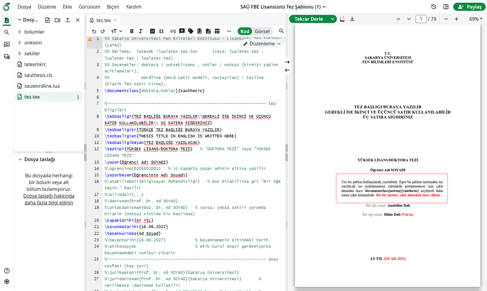

# SAÜ FBE Tez Şablonu + AyakaLeaf Pro

[](https://burhanbarakli.github.io/sau-fbe-ayakaleaf/)

<p align="center"><sub>Şablondan açılan proje: solda <code>tez.tex</code>, sağda LuaLaTeX ile derlenmiş PDF.
<a href="https://burhanbarakli.github.io/sau-fbe-ayakaleaf/">Resimli kurulum ve kullanım kılavuzu</a></sub></p>

Kendi bilgisayarınızda (ya da bölümünüzün sunucusunda) çalışan, **Overleaf benzeri çevrimiçi bir LaTeX
editörü** kurar ve içine **Sakarya Üniversitesi Fen Bilimleri Enstitüsü lisansüstü tez şablonunu** hazır
şablon olarak ekler. Kurulumdan sonra proje listenizde şablonun hazır bir kopyası (**Tezim**) durur: açın,
adını değiştirin ve yazmaya başlayın. Yeni kopyalar için şablon galeride de durur (**Yeni Proje → Diğer şablonlar →
Tezler**). AyakaLeaf yollarında TeX dağıtımı kurmanız gerekmez.

Üç kurulum yolu var. İlk ikisi tarayıcıda açılan, Overleaf benzeri **AyakaLeaf**'i kurar. Üçüncüsü AyakaLeaf'siz,
en basit yoldur: bilgisayarınıza bir LaTeX dağıtımı ve ücretsiz bir masaüstü editör (TeXstudio) kurup şablonu
doğrudan açarsınız; solda kod, sağda PDF.

| | [1. Taşınabilir (önerilen)](#kurulum-1-taşınabilir-önerilen) | [2. Docker](#kurulum-2-docker) | [3. Masaüstü editör (en basit)](#kurulum-3-masaüstü-editör-en-basit) |
|---|---|---|---|
| Editör | AyakaLeaf (tarayıcıda, Overleaf benzeri) | AyakaLeaf (tarayıcıda, Overleaf benzeri) | TeXstudio (kendi penceresinde) |
| Ne kurulur | Hiçbir şey: zip'i açıp **Baslat**'a çift tıklarsınız | WSL 2 (Windows), Docker, Toolkit | MiKTeX (Windows) ya da MacTeX (macOS) + TeXstudio |
| Sistem | Windows 10/11 (64 bit), macOS (Apple Silicon ya da Intel) | Windows (WSL 2), macOS, Linux | Windows, macOS, Linux |
| İndirme / süre | Tek zip (~1,2 GB), ilk açılış birkaç dakika | ~30 GB imaj, 15–60 dakika | MiKTeX ~150 MB (eksik paketler ilk derlemede iner) ya da MacTeX ~6 GB; 10–30 dakika |
| Proje geçmişi, ortak düzenleme, şablon galerisi | Var | Var | Yok (geçmiş için Git kullanılabilir) |
| Uygun olduğu yer | Kendi bilgisayarında tez yazan öğrenci | Bölüm/laboratuvar sunucusu, çok kullanıcı, Zotero bağlantısı, korumalı derleme | Sunucu ya da tarayıcı istemeyen, en hafif ve en hızlı derlemeyi isteyen |

- **Şablonun kendisi (LaTeX, Word karşılaştırması):** <https://github.com/burhanbarakli/sau-fbe-doktora-latex-sablonu>
- **Şablonun resimli kullanım kılavuzu:** <https://burhanbarakli.github.io/sau-fbe-doktora-latex-sablonu/>
- **Bu kurulumun resimli kılavuzu:** <https://burhanbarakli.github.io/sau-fbe-ayakaleaf/>
- **AyakaLeaf Pro:** <https://ayakaleaf-pro.ayaka.space/> (Overleaf Community Edition tabanlı, ücretsiz, AGPL-3.0)

> Docker yolu resmi [AyakaLeaf Toolkit](https://github.com/ayaka-notes/toolkit)'ini indirir, ayarlar ve şablonu
> yükler. Taşınabilir paket, AyakaLeaf Pro'nun resmi Docker imajındaki derlenmiş kodun Windows ve macOS'ta
> doğrudan çalışacak biçimde paketlenmiş halidir ([`tasinabilir/`](tasinabilir)). Overleaf, AyakaLeaf ve SAÜ FBE
> ile resmi bir bağı yoktur.

## Kurulum 1: Taşınabilir (önerilen)

Docker, WSL, TeX dağıtımı, MongoDB ya da başka bir program kurmanız gerekmez; her şey tek klasördedir.

1. Bilgisayarınıza uygun paketi indirin:

   | Bilgisayar | İndir |
   |---|---|
   | Windows 10/11 (64 bit) | [**AyakaLeaf-SAU-Windows.zip**](https://github.com/burhanbarakli/sau-fbe-ayakaleaf/releases/latest/download/AyakaLeaf-SAU-Windows.zip) |
   | Mac, Apple Silicon (M1, M2, M3, M4) | [**AyakaLeaf-SAU-macOS-AppleSilicon.zip**](https://github.com/burhanbarakli/sau-fbe-ayakaleaf/releases/latest/download/AyakaLeaf-SAU-macOS-AppleSilicon.zip) |
   | Mac, Intel işlemci | [**AyakaLeaf-SAU-macOS-Intel.zip**](https://github.com/burhanbarakli/sau-fbe-ayakaleaf/releases/latest/download/AyakaLeaf-SAU-macOS-Intel.zip) |

   Mac'inizin işlemcisini sol üstteki Apple menüsü → **Bu Mac Hakkında**'da görürsünüz (*Yonga: Apple M…* ya da *İşlemci: Intel*).
   Bütün sürümler: [Releases](https://github.com/burhanbarakli/sau-fbe-ayakaleaf/releases).
2. Zip'i açın:
   - **Windows:** zip'e sağ tıklayın → **Tümünü ayıkla** → hedef olarak `C:\AyakaLeaf` yazın. Klasör yolunda
     Türkçe karakter (ı, ş, ğ…) olmaması önerilir; LaTeX bu tür yollarda hata verebilir.
     Gezgin yavaş kalırsa (binlerce dosya vardır) PowerShell'de daha hızlı açılır:
     `mkdir C:\AyakaLeaf; tar -xf "$HOME\Downloads\AyakaLeaf-SAU-Windows.zip" -C C:\AyakaLeaf`
   - **macOS:** zip'e çift tıklayın; `AyakaLeaf-SAU` klasörünü **Uygulamalar**'a ya da ev klasörünüze taşıyın.
3. `AyakaLeaf-SAU` klasöründe başlatıcıya çift tıklayın:
   - **Windows:** `Baslat.bat`. *"Windows kişisel bilgisayarınızı korudu"* uyarısı çıkarsa **Ek bilgi → Yine de çalıştır**.
   - **macOS:** `Baslat.command`. *"Açılamıyor, geliştirici doğrulanamadı"* uyarısı çıkarsa **Sistem Ayarları →
     Gizlilik ve Güvenlik** → en altta **Yine de Aç** (eski macOS'ta: dosyaya sağ tık → **Aç** → **Aç**).
     Başlatıcı, paketteki diğer programların engellenmemesi için karantina işaretini kendisi kaldırır.
4. İlk açılışta hiçbir şey sorulmaz: şablon yüklenip derlenir. İlk derlemede yazı tipi önbelleği oluştuğu
   için birkaç dakika sürebilir.
5. Bitince tarayıcı kendiliğinden <http://localhost:8080> adresini açar. Şu bilgilerle giriş yapın; proje
   listesinde **Tezim** hazır durur:

   | E-posta | Şifre |
   |---|---|
   | `tez@sau.local` | `sakarya2026` |

   Şifreyi değiştirmek için sağ üstte **Hesap → Hesap Ayarları → Şifre Değiştir** (aynı sayfada e-postayı da
   değiştirebilirsiniz). Site yalnızca bu bilgisayardan açılır; aynı ağdaki başkaları erişemez.

**Gereken:** 64 bit Windows 10/11 ya da macOS 12 ve üstü, en az **4 GB** bellek (8 GB önerilir), **6 GB** boş
disk (paket açılınca ~4 GB, artı projeleriniz). İnternet yalnızca indirirken gerekir.

**Her gün:** `Baslat`'a çift tıklayın; pencere açık kaldığı sürece AyakaLeaf çalışır, kapatınca durur. Pencere
zaten açıkken yeniden çift tıklarsanız yalnızca tarayıcı açılır.

**Projeleriniz** `AyakaLeaf-SAU/veri` klasöründedir. **Yedek** için AyakaLeaf kapalıyken `veri` klasörünü
kopyalayın (ya da projeyi editörden **Menü → Kaynak kodunu indir** ile ZIP olarak alın). **Yeni sürüme
geçmek** için yeni zip'i açın, eski klasördeki `veri` klasörünü yenisinin içine kopyalayın ve yeni `Baslat`'ı
çalıştırın.

### Nasıl çalışır? (taşınabilir)

```
 Tarayıcı ──► http://localhost:8080
                │
   ┌────────────┴──────── Baslat (app/baslat.mjs, Node.js) ─────────────┐
   │  AyakaLeaf Pro    12 servis: editör, derleyici, geçmiş, şablon galerisi │
   │  MongoDB          kullanıcılar, projeler, şablon kayıtları             │
   │  Garnet           Redis uyumlu: anlık ortak düzenleme (Microsoft, .NET) │
   │  TeX Live 2026    LuaLaTeX, latexmk, biber (app/texlive)               │
   └──────────────────────────────────────────────────────────────────────┘
   Veriler: AyakaLeaf-SAU/veri/    Günlükler: AyakaLeaf-SAU/veri/log/
```

Paketler GitHub Actions'ta [`tasinabilir.yml`](.github/workflows/tasinabilir.yml) ile üretilir: AyakaLeaf Pro'nun
resmi Docker imajındaki derlenmiş kod alınır, Windows/macOS farkları için [`yamala.mjs`](tasinabilir/yamala.mjs)
ile küçük düzeltmeler yapılır, Node.js, MongoDB, Garnet, .NET çalışma zamanı ve taşınabilir TeX Live
eklenir. Her paket yayınlanmadan önce Windows ve macOS'ta başlatıcı çalıştırılıp şablon derlenerek sınanır.

Taşınabilir pakette derleme korumalı kapta (sandbox) değil, doğrudan bilgisayarınızda çalışır; kendi
projeleriniz için sorun değildir, ama başkalarına açık bir sunucu kuracaksanız Docker yolunu kullanın. Paketteki
TeX Live seçme paketlerden oluşur ([liste](tasinabilir/tex-paketleri.txt)); şablonun ve sık kullanılan tez
paketlerinin (TikZ, pgfplots, siunitx, algoritmalar, biblatex…) dışında bir paket gerekirse
`app/texlive/bin/<sistem>/tlmgr install <paket>` ile ekleyebilirsiniz.

## Kurulum 2: Docker

Bölüm ya da laboratuvar sunucusu, çok kullanıcı, korumalı derleme, Zotero/Mendeley bağlantısı ya da tam TeX
Live gerekiyorsa bu yolu kullanın.

### Nasıl çalışır?

```
 Tarayıcı ──► http://localhost:8080
                │
   ┌────────────┴───────────── Docker ──────────────────────────────┐
   │  sharelatex   AyakaLeaf Pro: editör, proje listesi, şablon galerisi │
   │  mongo        kullanıcılar, projeler, şablon kayıtları             │
   │  redis        anlık ortak düzenleme                               │
   │  texlive-full her "Derle"de açılıp kapanan TeX Live 2026 kabı      │
   │               (LuaLaTeX burada çalışır; bilgisayarınıza TeX kurulmaz) │
   └────────────────────────────────────────────────────────────────┘
   Veriler: ~/ayakaleaf-toolkit/data/   Ayarlar: ~/ayakaleaf-toolkit/config/
```

`kur.sh` sırasıyla şunları yapar:

1. İşletim sistemini ve Docker'ı denetler (Docker yoksa Linux/WSL'de kurmayı önerir).
2. AyakaLeaf Toolkit'i `~/ayakaleaf-toolkit` klasörüne indirir ve `bin/init` ile ayar dosyalarını oluşturur.
3. Ayarları yazar: AyakaLeaf Pro imajı, port 8080, Türkçe arayüz, TeX Live 2026 full, korumalı (sandbox)
   derleme, **şablon galerisi** ve "Tezler" kategorisi.
4. `bin/up -d` ile kapları başlatır (ilk seferde imajlar iner).
5. `sablonu-yayinla.py` ile ilk **yönetici hesabını** oluşturur, şablonun son sürümünü GitHub'dan indirir,
   proje olarak yükler, derleyiciyi **LuaLaTeX** yapıp derler ve galeride yayınlar.
6. Yönetici hesabında henüz proje yoksa şablonun bir kopyasını **Tezim** adıyla hazır proje olarak oluşturur.
   Hesapta zaten proje varsa (adı değiştirilmiş olsa bile) yeni kopya eklemez.

### Gereksinimler

| | Windows 10/11 | macOS | Linux (Ubuntu/Debian) |
|---|---|---|---|
| Sanallaştırma | **WSL 2** + Ubuntu (`wsl --install -d Ubuntu`); BIOS'ta sanallaştırma açık | Docker Desktop'ın desteklediği macOS (Apple Silicon veya Intel) | — |
| Docker | **Docker Desktop** (WSL 2 altyapısı, *WSL Integration* açık) **ya da** Ubuntu içinde Docker Engine (`kur.sh` kurabilir) | **Docker Desktop** (Settings → Advanced → *Allow the default Docker socket*) | Docker Engine 25–29 + `docker compose` eklentisi (`kur.sh` kurabilir) |
| Araçlar | Ubuntu içinde: `git curl openssl python3 perl gawk` | Xcode Command Line Tools (`git`, `python3`), [Homebrew](https://brew.sh), `gnu-sed` (`kur.sh` kurar) | `git curl openssl python3 perl gawk` |
| Bellek / CPU | Docker'a en az 4 GB, önerilen **8 GB** ve 4 CPU | Aynı (Docker Desktop → Resources) | Aynı |
| Disk | **50 GB** boş alan (TeX Live full imajı diskte ~29 GB, AyakaLeaf + MongoDB ~4 GB, artı projeleriniz) | Aynı (Docker Desktop disk sınırını da kontrol edin) | Aynı |
| İnternet | Yalnızca kurulumda (imajlar ve şablon indirilir); sonrası çevrimdışı çalışır | Aynı | Aynı |

Bilgisayarınıza MiKTeX/MacTeX, MongoDB ya da Redis kurmanız **gerekmez**; hepsi Docker kaplarında çalışır.

### Windows

1. **PowerShell'i yönetici olarak** açın:
   ```powershell
   wsl --install -d Ubuntu
   ```
   İstenirse yeniden başlatın. Başlat menüsünden **Ubuntu**'yu açıp Linux kullanıcı adı ve şifresi belirleyin.
2. Docker için iki yoldan birini seçin:
   - **Docker Desktop (önerilen)** ([indir](https://docs.docker.com/desktop/setup/install/windows-install/)): kurun,
     açın, **Settings → Resources → WSL Integration** altında **Ubuntu**'yu açıp *Apply & restart* deyin.
     Docker Desktop açık olduğu sürece site çalışır.
   - **Docker Engine (Ubuntu içinde, ücretsiz, Windows'a bir şey kurmaz):** hiçbir şey kurmayın; `kur.sh` Docker
     bulamazsa kurmayı önerir (Linux şifrenizi sorar). Kurulumdan sonra Ubuntu penceresini kapatıp yeniden açın ve
     `./kur.sh`'ı tekrar çalıştırın. **Dikkat:** bu yolda açık bir Ubuntu penceresi kalmadığında Windows WSL'i
     birkaç saniye sonra kapatır ve site de kapanır; Ubuntu'yu yeniden açınca kaplar kendiliğinden başlar.
     Tez yazarken bir Ubuntu penceresini açık bırakın.
3. **Ubuntu** terminalinde (PowerShell'de değil):
   ```bash
   sudo apt update && sudo apt install -y git curl openssl python3 perl gawk
   cd ~
   git clone https://github.com/burhanbarakli/sau-fbe-ayakaleaf.git
   cd sau-fbe-ayakaleaf
   ./kur.sh
   ```
4. Betik bittiğinde Windows tarayıcınızda <http://localhost:8080> adresini açın.

> Toolkit'i ve verileri `/mnt/c/...` altına değil, Ubuntu'nun ev klasörüne kurun (betik bunu varsayılan olarak yapar).

### macOS

1. [Docker Desktop](https://docs.docker.com/desktop/setup/install/mac-install/)'ı kurup açın. **Settings →
   Resources**'ta en az 4 CPU / 8 GB bellek verin; **Settings → Advanced → Allow the default Docker socket to
   be used** seçeneğini açın.
2. [Homebrew](https://brew.sh) yoksa kurun. Terminal'de:
   ```bash
   cd ~
   git clone https://github.com/burhanbarakli/sau-fbe-ayakaleaf.git
   cd sau-fbe-ayakaleaf
   ./kur.sh
   ```
   (`git` ilk çalıştırmada Command Line Tools kurmayı önerirse kabul edin.)
3. <http://localhost:8080> adresini açın.

### Linux

```bash
sudo apt update && sudo apt install -y git curl openssl python3 perl gawk
git clone https://github.com/burhanbarakli/sau-fbe-ayakaleaf.git
cd sau-fbe-ayakaleaf
./kur.sh
```

### Kurulum sırasında sorulanlar

- **Yönetici e-postası ve şifresi:** AyakaLeaf'e giriş bilgileriniz olur. İkisinde de **Enter**'a basarsanız
  varsayılan hesap kullanılır: `tez@sau.local` / `sakarya2026` (sonra **Hesap → Hesap Ayarları**'ndan
  değiştirin). Kendi şifrenizi yazacaksanız en az 8 karakter olmalı ve e-postaya benzememeli. Daha önce
  yönetici oluşturduysanız aynı bilgileri girin. Sunucuyu ağa açacaksanız varsayılan şifreyi mutlaka değiştirin.
- **Docker Engine kurulsun mu?** Yalnızca Linux/WSL'de Docker yoksa sorulur.

İlk kurulum, TeX Live imajının boyutu nedeniyle bağlantınıza göre 15–60 dakika sürebilir. Sonraki
başlatmalar saniyeler içinde olur.

## Kurulum 3: Masaüstü editör (en basit)

AyakaLeaf yok, sunucu yok, tarayıcı yok: bilgisayarınıza bir LaTeX dağıtımı ve [TeXstudio](https://www.texstudio.org/)
editörünü kurar, şablonu doğrudan açarsınız. Solda kod, sağda PDF; ikisi de ücretsiz ve açık kaynaktır. Derleme en
hızlı bu yoldadır. Proje geçmişi, ortak düzenleme ve şablon galerisi yoktur.

1. **LaTeX dağıtımını kurun:**

   | Bilgisayar | Kurulum |
   |---|---|
   | Windows | [MiKTeX](https://miktex.org/download)'i indirip kurun. Kurulumda *Install missing packages on-the-fly* için **Yes** seçin (eksik paketleri sormadan indirir). |
   | macOS | [MacTeX](https://tug.org/mactex/mactex-download.html)'i indirip kurun (~6 GB, her şey içinde). |
   | Linux | `sudo apt install texlive-full` (ya da dağıtımınızın TeX Live paketi) |

   Komut satırını seviyorsanız: Windows'ta `winget install MiKTeX.MiKTeX`, ardından
   `initexmf --set-config-value [MPM]AutoInstall=1`; macOS'ta `brew install --cask mactex-no-gui`.
2. **TeXstudio'yu kurun:** <https://www.texstudio.org/> (Windows'ta `winget install TeXstudio.TeXstudio`, macOS'ta
   `brew install --cask texstudio`, Linux'ta `sudo apt install texstudio`). macOS *"açılamıyor"* derse **Sistem
   Ayarları → Gizlilik ve Güvenlik → Yine de Aç**.
3. **Şablonu indirin:** [**sau-fbe-doktora-latex-sablonu (ZIP)**](https://github.com/burhanbarakli/sau-fbe-doktora-latex-sablonu/archive/refs/heads/main.zip).
   Zip'i açın ve içindeki `sablon` klasörünü istediğiniz yere kopyalayıp adını değiştirin (ör. `Belgeler\Tezim`).
   Windows'ta klasör yolunda Türkçe karakter olmaması önerilir.
4. **TeXstudio'da `tez.tex`'i açın ve F5'e basın** (*Derle ve Göster*). PDF sağda açılır. `tez.tex`'in ilk iki satırı
   (`% !TeX program = lualatex`, `% !BIB program = biber`) TeXstudio'ya derleyiciyi söyler; hiçbir ayar yapmanız
   gerekmez, bu satırları silmeyin. İlk derleme birkaç dakika sürebilir: MiKTeX eksik paketleri indirir, yazı
   tipi önbelleği oluşur. İçindekiler ya da şekil listesi boş görünürse **F5**'e bir kez daha basın.

PDF'te bir yere **Ctrl+tıklayınca** (macOS'ta **Cmd+tıklama**) TeXstudio koddaki ilgili satıra gider. Tez bilgilerini
`tez.tex`'in başına, bölümleri `bolumler/` altına yazarsınız; bütün kurallar ve örnekler şablonun
[kullanım kılavuzundadır](https://burhanbarakli.github.io/sau-fbe-doktora-latex-sablonu/).

**Kaynakça için .bib (Zotero/Mendeley) kullanırsanız:** `tez.tex`'teki `\input{bib-ayar}` satırını açtıktan sonra
kaynak ekleyince bir kez **F8** (*Araçlar → Kaynakça*, Biber'i çalıştırır) sonra **F5**'e basın. Atıflar `[?]`
görünüyorsa aynısını yapın.

**Başka editörler:** VS Code + [LaTeX Workshop](https://marketplace.visualstudio.com/items?itemName=James-Yu.latex-workshop)
eklentisi şablondaki `latexmkrc`'yi okuyup kaydettikçe derler (Windows'ta MiKTeX'in `latexmk`'si için Perl gerekir:
`winget install StrawberryPerl.StrawberryPerl`). MiKTeX ve MacTeX ile gelen TeXworks da `tez.tex`'in ilk satırını
okuyup LuaLaTeX ile derler.

## Kullanım

Bu bölüm AyakaLeaf yolları (Kurulum 1 ve 2) için geçerlidir; Kurulum 3'te tezi TeXstudio'da yazarsınız.

1. <http://localhost:8080> → yönetici e-postanız ve şifrenizle giriş yapın (varsayılan: `tez@sau.local` /
   `sakarya2026`; değiştirmek için **Hesap → Hesap Ayarları → Şifre Değiştir**).
2. Proje listesinde **Tezim** hazır durur. Adını değiştirmek için satırın onay kutusunu işaretleyip
   **Daha fazla → Adlandır**'ı seçin (ya da editörde üstteki proje adına tıklayın). Projeye tıklayıp açın;
   derleyici LuaLaTeX olarak ayarlıdır.
3. Başka bir kopya gerekirse (örneğin ikinci bir tez ya da başka bir kullanıcı için): **Yeni Proje → Diğer
   şablonlar → Tezler** ya da <http://localhost:8080/templates/thesis> → **SAÜ FBE Lisansüstü Tez Şablonu** →
   **Şablon Olarak Aç**. Sol taraftaki dosya ağacında:
   - `tez.tex`: tez başlığı, adınız, anabilim dalı, danışman, jüri ve bölüm sırası,
   - `onkisim/`: teşekkür, özet, summary, kısaltmalar, simgeler,
   - `bolumler/`: bölümler, kaynaklar, ekler, özgeçmiş,
   - `sekiller/`: görseller (sürükle-bırak ile yükleyin).
4. **Derle** (Ctrl+S / Ctrl+Enter) ile PDF'i sağda görün; **İndir** ile PDF'i alın.
5. Teslimden önce `tez.tex`'in ilk satırında `notlar` yerine `notsuz` yazın.

> **Arşivlenmiş projeler**'deki "SAÜ FBE Lisansüstü Tez Şablonu" galerinin kaynağıdır; şablon güncellenince
> silinir. Tezinizi onun içine değil, **Tezim**'e (ya da galeriden açtığınız kopyaya) yazın.

Şablondaki her komutun ne yaptığı ve hangi sayfayı değiştirdiği: [şablon kılavuzu](https://burhanbarakli.github.io/sau-fbe-doktora-latex-sablonu/).

### Başka kullanıcılar eklemek

Yönetici olarak sağ üstte **Admin → Kullanıcı yönetimi → Hesap oluştur** ile öğrencileri/danışmanları ekleyin;
projeyi **Paylaş** düğmesiyle birlikte düzenleyebilirsiniz. Hazır **Tezim** projesi yalnızca yönetici hesabına
konur; yeni kullanıcılar kendi kopyalarını galeriden **Şablon Olarak Aç** ile açar. Varsayılan ayar yalnızca bu bilgisayardan erişime
izin verir (`127.0.0.1`). Ağdaki başka bilgisayarların erişmesi için `config/overleaf.rc`'de
`OVERLEAF_LISTEN_IP` ve `config/variables.env`'de `OVERLEAF_SITE_URL` değiştirilmeli, ağ/güvenlik duvarı ve
HTTPS ayarlanmalıdır; bkz. [AyakaLeaf belgeleri](https://ayakaleaf-pro.ayaka.space/on-premises/).

## Kaynaklar, Zotero ve Mendeley

Şablonda kaynakça iki yolla yazılır (ayrıntılar ve örnekler [şablon kılavuzunda](https://burhanbarakli.github.io/sau-fbe-doktora-latex-sablonu/#kaynaklar)):

1. **Elle (varsayılan):** `bolumler/kaynaklar.tex`'e her kaynak için `\kaynak{...}` (APA) ya da
   `\begin{kaynaklistesi} \item ... \end{kaynaklistesi}` (numaralı [1]); metin içi atıflar da elle yazılır:
   `(Baran, 2003)`, `[1]`.
2. **`.bib` dosyasından:** kaynak listesi ve atıflar Zotero, Mendeley ya da JabRef'ten gelen `.bib` dosyasından
   üretilir; sıralama, "ve ark." ve kılavuz biçimi kendiliğinden olur. Projede:
   - `tez.tex`'in başındaki `\input{bib-ayar}` ve `\addbibresource{zotero.bib}` satırlarının `%` işaretini silin
     (numaralı düzen için `\newcommand\kaynakduzeni{numarali}` satırını da açın),
   - `bolumler/kaynaklar.tex`'in içeriğini `\bolumsuz{KAYNAKLAR}` ve `\printbibliography[heading=none]` yapın,
   - metinde `\textcite{anahtar}` → Baran (2003), `\parencite{anahtar}` → (Baran, 2003), numaralı düzende
     `\cite{anahtar}` → [1] yazın ve **Derle**'ye basın (biber kendiliğinden çalışır).

> Projenizde `bib-ayar.tex` yoksa proje bu dosya eklenmeden önceki şablon sürümünden açılmıştır. Dosyayı
> [GitHub'dan](https://github.com/burhanbarakli/sau-fbe-doktora-latex-sablonu/blob/main/sablon/bib-ayar.tex)
> indirip **Yeni Dosya → Yükle** ile ekleyin. Docker yolunda galeriyi güncellemek için `./kur.sh --sablon`.

**Kaynak arama:** `\parencite{` (ya da `\cite{`, `\textcite{`) yazıp **Ctrl+Space**'e basın. Açılan
**Bu projedeki .bib dosyalarında ara** penceresinde yazar, başlık ya da anahtarın birkaç harfini yazın ve
**Ekle**'ye basın; anahtar atıfın içine yazılır. Bu özellik ayar gerektirmez.

<a href="docs/img/kaynak_arama.png"></a>

### `.bib` dosyasını projeye almak

| Yol | Ne zaman | Nasıl |
|---|---|---|
| **Zotero bağlantısı** | Kütüphaneniz zotero.org ile eşitleniyorsa | Yönetici bir kez açar (aşağıda). Sonra **Hesap → Hesap Ayarları → Referans yöneticileri → Zotero'ya bağlan**. Projede **Yeni Dosya → Zotero'dan** → dosya adı `zotero.bib`, kütüphane ya da grup seçin → **Oluştur**. Zotero'da değişiklik yaptıktan sonra dosyayı açıp **Yenile**'ye basın. |
| **Mendeley bağlantısı** | Mendeley kullanıyorsanız | Aynı adımlar: **Mendeley'e bağlan**, **Yeni Dosya → Mendeley'dan**. |
| **Zotero + Better BibTeX** | Bağlantı açık değilse ya da çevrimdışı | Bilgisayarınızda Zotero'ya [Better BibTeX](https://retorque.re/zotero-better-bibtex/) kurun, koleksiyonu **Better BibLaTeX** olarak dışa aktarın, `.bib`'i **Yeni Dosya → Yükle** ile ekleyin. Kaynak ekledikçe yeniden yükleyin. |
| **Mendeley / JabRef / EndNote** | Diğer araçlar | BibTeX ya da BibLaTeX olarak dışa aktarıp **Yükle**. |

Bağlantıyla gelen `.bib` editörde **salt okunurdur** ve yalnızca onu ekleyen kişi yenileyebilir; projeyi
paylaştığınız danışman dosyayı görür ama yenileyemez. Bu özellik AyakaLeaf'te henüz beta durumundadır.
"Zotero'dan" seçeneği **Yeni Dosya** penceresinde yalnızca hesabınız bağlandıktan sonra görünür.

<a href="docs/img/zotero_ayar.png"></a>

### Zotero / Mendeley bağlantısını açmak (yönetici, bir kez)

1. **Zotero:** <https://www.zotero.org/oauth/apps> → *Register a new application*. Uygulama türü **Browser**,
   *Callback URL* `http://localhost:8080/user/zotero/oauth/callback` (portu değiştirdiyseniz onu yazın).
   Verilen **Client Key** ve **Client Secret**'ı not edin.
   **Mendeley:** <https://dev.mendeley.com/myapps.html> → yeni uygulama, *Redirect URL*
   `http://localhost:8080/user/mendeley/oauth/callback`, yetkilendirme akışı **Elsevier**. **ID** ve **Secret**'ı not edin.
2. Bu depo klasöründe `kur.sh`'ı anahtarlarla yeniden çalıştırın (mevcut kurulum ve projeler korunur):
   ```bash
   ZOTERO_CLIENT_ID=... ZOTERO_CLIENT_SECRET=... ./kur.sh
   ```
   Mendeley için `MENDELEY_CLIENT_ID=... MENDELEY_CLIENT_SECRET=...` ekleyin; ikisi birlikte verilebilir. Betik
   `config/variables.env`'e `ENABLED_LINKED_FILE_TYPES` (zotero/mendeley eklenir), istemci anahtarlarını ve
   `ZOTERO_CIPHER_PASSWORD` / `MENDELEY_CIPHER_PASSWORD` şifreleme anahtarını yazar ve sunucuyu yeniden başlatır.
   Elle yapmak isterseniz aynı satırları ekleyip `bin/up -d` çalıştırın.

Sunucunun internete açık olması gerekmez: bağlanma tarayıcınız üzerinden olur, sunucu yalnızca zotero.org ve
Mendeley API'sine erişebilmelidir (gerekirse `ZOTERO_PROXY_URL` / `MENDELEY_PROXY_URL`). Ayrıntı: AyakaLeaf
belgeleri, [Zotero](https://ayakaleaf-pro.ayaka.space/on-premises/configuration/overleaf-toolkit/integrations/zotero-integration.md)
ve [Mendeley](https://ayakaleaf-pro.ayaka.space/on-premises/configuration/overleaf-toolkit/integrations/mendeley-integration.md).

### Diğer eklentiler

AyakaLeaf Pro'da kaynak yönetimi dışında da şu özellikler vardır. `kur.sh` bunları ayarlamaz; açmak ya da
yapılandırmak için AyakaLeaf belgelerine bakın:

| Özellik | Ne işe yarar |
|---|---|
| [GitHub / GitLab / Gitea eşitleme](https://ayakaleaf-pro.ayaka.space/on-premises/readme/features-and-copyright.md) | Projeyi bir Git deposuyla iki yönlü eşitler (tezin sürüm geçmişi ve yedeği). |
| [Dropbox eşitleme](https://ayakaleaf-pro.ayaka.space/on-premises/readme/features-and-copyright.md) | Proje dosyalarını Dropbox klasörüyle eşitler. |
| [MCP sunucusu](https://ayakaleaf-pro.ayaka.space/on-premises/configuration/overleaf-toolkit/integrations/mcp-server.md) | Claude Code gibi yapay zekâ araçlarının projeyi okuyup düzenlemesine ve derlemesine izin verir. |
| [Yapay zekâ asistanı](https://ayakaleaf-pro.ayaka.space/on-premises/readme/features-and-copyright.md) | Proje hakkında sohbet ve derleme hatalarını açıklama. |

## Günlük kullanım (Docker)

Taşınabilir pakette yalnızca `Baslat`'a çift tıklarsınız (bkz. [Kurulum 1](#kurulum-1-taşınabilir-önerilen)). Docker yolunda:
Windows'ta önce Docker Desktop'ı açın (Docker Engine yolundaysanız bir Ubuntu penceresi açmanız yeter; kaplar
kendiliğinden başlar), sonra gerekirse Ubuntu/Terminal'de:

| İş | Komut (`cd ~/ayakaleaf-toolkit` içinde) |
|---|---|
| Başlat | `bin/start` |
| Durdur (veriler kalır) | `bin/stop` |
| Ayar değişikliğini uygula | `bin/up -d` |
| Durum | `bin/docker-compose ps` |
| Uygulama günlüğü | `bin/docker-compose logs --tail=100 sharelatex` |
| Derleyici günlüğü | `bin/logs -f clsi` |

**Şablonu güncellemek** (GitHub'daki şablona yeni sürüm geldiğinde): sunucu çalışırken bu depo klasöründe

```bash
./kur.sh --sablon
```

Galerideki şablon yeni sürümle değişir; **Tezim** ve daha önce açılmış tez projeleri etkilenmez (yeni hazır
proje de eklenmez).

**Yedek:** `~/ayakaleaf-toolkit/config/` ve `~/ayakaleaf-toolkit/data/` klasörleri bütün verilerinizdir.
Yedeklemeden önce `bin/stop` ile durdurun. Ayrıca her projeyi **Menü → Kaynak kodunu indir** ile ZIP olarak
alabilirsiniz.

## Sorun giderme

**Taşınabilir paket:**

| Belirti | Çözüm |
|---|---|
| Pencere "Şu portlar başka bir program tarafından kullanılıyor" deyip kapanıyor | Bilgisayarda MongoDB, Redis ya da Docker'lı AyakaLeaf/Overleaf çalışıyor. Onları durdurup `Baslat`'ı yeniden açın. 8080 doluysa paket kendiliğinden 8081, 8082… kullanır; adres pencerede yazar. |
| macOS: "Baslat.command açılamıyor" | **Sistem Ayarları → Gizlilik ve Güvenlik → Yine de Aç**. Olmazsa Terminal'de `xattr -dr com.apple.quarantine ~/AyakaLeaf-SAU` (klasörün yerini yazın) ve yeniden çift tıklayın. |
| Windows: pencere açılıp hemen kapanıyor | Zip'i açmadan zip'in içinden çalıştırmışsınızdır: önce **Tümünü ayıkla**. |
| Derleme hata veriyor, günlükte Türkçe karakterli bir klasör yolu var | Klasörü `C:\AyakaLeaf` gibi Türkçe karakter içermeyen bir yere taşıyın. |
| Şablon yüklenemedi (ilk kurulum) | AyakaLeaf yine çalışır; pencereyi kapatıp `Baslat`'ı yeniden açınca kurulum tekrar denenir. Ayrıntı: `veri/log/` içindeki günlükler (`web.log`, `clsi.log`). |
| "... .sty not found" | Paket taşınabilir TeX Live'da yok: `app/texlive/bin/windows/tlmgr install <paket>` (macOS: `app/texlive/bin/universal-darwin/tlmgr`). |

**Docker:**

| Belirti | Çözüm |
|---|---|
| `docker: command not found` / `Cannot connect to the Docker daemon` (Windows) | Docker Desktop açık mı? *Settings → Resources → WSL Integration*'da Ubuntu açık mı? Ubuntu penceresini kapatıp açın. Docker Engine kurduysanız: `sudo service docker start`. |
| `permission denied ... docker.sock` | `sudo usermod -aG docker $USER` sonra terminali kapatıp açın. Soketin iznini `777` yapmayın. |
| `sed: illegal option` (macOS) | GNU sed yolda değil: `export PATH="$(brew --prefix gnu-sed)/libexec/gnubin:$PATH"` ve `./kur.sh`'ı yeniden çalıştırın. |
| `Mounts denied` (macOS) | Toolkit'i `/Users/...` altında tutun ya da Docker Desktop → *File sharing*'e klasörü ekleyin. |
| Sayfa açılmıyor | İlk açılış birkaç dakika sürebilir. `bin/docker-compose logs --tail=100 sharelatex` ile bakın. |
| MongoDB açılmıyor | Docker çekirdeği 6.19–7.0.13 ise `kur.sh` geçici çözümü kendisi ekler; Docker Desktop'ı güncelleyin. |
| Site, Ubuntu penceresini kapatınca açılmıyor (Windows, Docker Engine yolu) | Beklenen durum: WSL boşta kalınca kapanır. Ubuntu'yu açın, kaplar birkaç saniyede başlar (`docker ps`). Sürekli açık kalması için Docker Desktop yolunu kullanın. |
| Formüllerin yazı tipi Word'den farklı | TeX Live imajında Times New Roman vardır (metin Word ile aynı kırılır) ama Cambria Math yoktur; formüller **STIX Two Math** ile dizilir. |
| Şablon galeride yok | Sunucu çalışırken `./kur.sh --sablon`. |
| Port 8080 dolu | `AYAKALEAF_PORT=8090 ./kur.sh` |
| **Yeni Dosya** penceresinde "Zotero'dan" yok | Önce **Hesap Ayarları → Zotero'ya bağlan**. Ayarlarda *Referans yöneticileri* bölümü hiç yoksa bağlantı açılmamıştır: [Zotero / Mendeley bağlantısını açmak](#zotero--mendeley-bağlantısını-açmak-yönetici-bir-kez). |
| Atıf yerine anahtar ya da soru işareti çıkıyor, kaynakça boş | `\addbibresource{...}`'taki ad `.bib` dosyasının adıyla aynı mı? Anahtar `.bib`'de var mı? Zotero dosyasını açıp **Yenile**'ye basın, sonra yeniden derleyin. |

**Masaüstü editör (Kurulum 3):**

| Belirti | Çözüm |
|---|---|
| `fontspec ... requires either XeTeX or LuaTeX` | pdfLaTeX ile derlenmiş. `tez.tex`'in ilk satırı `% !TeX program = lualatex` olmalı; silindiyse geri yazın ya da TeXstudio'da **Seçenekler → TeXstudio'yu Yapılandır → Derleme → Varsayılan Derleyici: LuaLaTeX**. |
| TeXstudio "lualatex bulunamadı" diyor | MiKTeX/MacTeX kurulduktan sonra TeXstudio'yu kapatıp açın (gerekirse bilgisayarı yeniden başlatın). |
| Her derlemede "paket kurulsun mu" penceresi çıkıyor | **MiKTeX Console → Settings → Always install missing packages on-the-fly**. |
| Biber hata veriyor (`data file version` / `biblatex` uyuşmazlığı) | **MiKTeX Console → Updates → Check for updates → Update now**; Biber ile biblatex sürümleri birlikte güncellenmeli. |
| İlk derleme çok uzun sürüyor | Beklenen durum: paketler iniyor ve yazı tipi önbelleği oluşuyor. Sonraki derlemeler birkaç saniyedir. |

Ayrıntılı kurulum sorunları: AyakaLeaf'in [Windows](https://ayakaleaf-pro.ayaka.space/on-premises/installation/using-docker-compose/windows/troubleshooting)
ve [macOS](https://ayakaleaf-pro.ayaka.space/on-premises/installation/using-docker-compose/macos/troubleshooting) sorun giderme sayfaları.

## Claude ile kurulum

[Claude Code](https://claude.com/claude-code)'u açın (Claude masaüstü uygulamasındaki **Code** sekmesi ya da
terminalde `claude`) ve seçtiğiniz kurulum yolunun istemini yapıştırın. Claude her adımı denetler, bilgisayarınızda
bir şey değiştirmeden önce size sorar; yönetici şifresini siz girersiniz.

### Kurulum 1: Taşınabilir

```text
Bilgisayarıma SAÜ FBE tez şablonu gömülü AyakaLeaf Pro'nun taşınabilir paketini (Kurulum 1, Docker'sız) kurmamı istiyorum.
Depo: https://github.com/burhanbarakli/sau-fbe-ayakaleaf (README'deki "Kurulum 1: Taşınabilir" bölümünü oku ve ona göre ilerle).

1. İşletim sistemimi ve işlemcimi belirle: Windows 10/11 64 bit mi, macOS'ta Apple Silicon mı Intel mi (`uname -m`: arm64 ya da x86_64). Buna göre zip'i seç: AyakaLeaf-SAU-Windows.zip, AyakaLeaf-SAU-macOS-AppleSilicon.zip ya da AyakaLeaf-SAU-macOS-Intel.zip.
2. En az 6 GB boş disk olduğunu ve 8080, 4000, 3000-3100, 27017, 6379 portlarını başka bir programın (MongoDB, Redis, Docker'lı Overleaf/AyakaLeaf) kullanmadığını kontrol et. Kullanan varsa bana söyle; kapatmayı bana bırak.
3. Zip'i https://github.com/burhanbarakli/sau-fbe-ayakaleaf/releases/latest/download/<zip adı> adresinden İndirilenler klasörüme indir (~1,2 GB).
4. Zip'i aç. Windows'ta C:\AyakaLeaf klasörünü oluşturup Windows'un kendi tar'ıyla aç: `C:\Windows\System32\tar.exe -xf <zip> -C C:\AyakaLeaf` (PowerShell'in Expand-Archive'ı çok yavaştır; Git Bash'in tar'ı zip açamaz). macOS'ta `ditto -x -k <zip> ~/AyakaLeaf` ile aç ve `xattr -dr com.apple.quarantine ~/AyakaLeaf/AyakaLeaf-SAU` ile karantina işaretini kaldır. Hedefte zaten bir AyakaLeaf-SAU klasörü varsa üzerine yazma; içindeki veri klasörü projelerimdir, önce bana sor.
5. Başlatıcıyı ayrı bir pencerede aç: Windows'ta `start "" "C:\AyakaLeaf\AyakaLeaf-SAU\Baslat.bat"`, macOS'ta `open ~/AyakaLeaf/AyakaLeaf-SAU/Baslat.command`. Hiçbir şey sormaz; şablonu yükleyip varsayılan hesabı (tez@sau.local / sakarya2026) oluşturur.
6. Pencerede "KURULUM TAMAM" yazdığını bana sor, sonra http://localhost:8080/login adresinin yanıt verdiğini kontrol et. Sorun çıkarsa README'deki "Sorun giderme" bölümünün taşınabilir paket tablosuna ve AyakaLeaf-SAU/veri/log/ içindeki günlüklere (web.log, clsi.log) bak.
7. Bitince bana giriş bilgilerini ve şifreyi Hesap → Hesap Ayarları'ndan nasıl değiştireceğimi, her gün nasıl başlatacağımı (Baslat'a çift tıklama), projelerimin nerede durduğunu (AyakaLeaf-SAU/veri) ve nasıl yedek alacağımı özetle.
```

### Kurulum 2: Docker

```text
Bilgisayarıma SAÜ FBE tez şablonu gömülü AyakaLeaf Pro'yu Docker ile (Kurulum 2) kurmamı istiyorum.
Depo: https://github.com/burhanbarakli/sau-fbe-ayakaleaf (README'deki "Kurulum 2: Docker" bölümünü oku ve ona göre ilerle).

1. İşletim sistemimi belirle. Windows'taysam WSL 2 ve Ubuntu kurulu mu bak (`wsl --list --verbose`); değilse kurulum komutunu bana göster, yönetici PowerShell'de benim çalıştırmamı iste.
2. Docker'ın çalıştığını doğrula (Windows'ta Ubuntu içinden `docker version`; Client ve Server görünmeli). Yoksa README'deki seçenekleri anlat ve hangisini istediğimi sor. Docker Desktop'ı ve lisans onayını bana bırak; Ubuntu içine Docker Engine kurulacaksa komutları önce göster.
3. Gereken araçları (git curl openssl python3 perl gawk; macOS'ta Homebrew ve gnu-sed) kontrol et, eksikleri onayımla kur.
4. Depoyu ev klasörüme (Windows'ta Ubuntu'nun ev klasörüne, /mnt/c altına değil) klonla ve `./kur.sh`'ı çalıştır. Yönetici e-postası ve şifresi sorulunca bana sor: Enter'a basarsam varsayılan hesap (tez@sau.local / sakarya2026) kullanılır; kendi şifremi kullanacaksam sohbete yazdırma, betiğin istemine benim girmemi iste.
5. İmajlar inerken ilerlemeyi takip et; hata olursa README'deki sorun giderme tablosuna ve `bin/docker-compose logs` çıktısına göre düzelt.
6. Bitince http://localhost:8080/templates/thesis adresinde şablonun, proje listesinde de hazır "Tezim" projesinin durduğunu doğrula ve bana günlük kullanım komutlarını (bin/start, bin/stop) özetle.
```

### Kurulum 3: Masaüstü editör

```text
Bilgisayarıma SAÜ FBE LaTeX tez şablonunu TeXstudio masaüstü editörüyle (Kurulum 3) kurmamı istiyorum.
Depo: https://github.com/burhanbarakli/sau-fbe-ayakaleaf (README'deki "Kurulum 3: Masaüstü editör" bölümünü oku ve ona göre ilerle).

1. İşletim sistemimi belirle. `lualatex --version` ile bir TeX dağıtımı kurulu mu, TeXstudio kurulu mu bak.
2. Eksikleri kur; her kurulum komutunu çalıştırmadan önce bana göster ve onay al:
   - Windows: `winget install MiKTeX.MiKTeX`, ardından `initexmf --set-config-value [MPM]AutoInstall=1` (eksik paketleri sormadan kursun); `winget install TeXstudio.TeXstudio`.
   - macOS: `brew install --cask mactex-no-gui` ve `brew install --cask texstudio` (Homebrew yoksa önce bana sor).
   - Linux: `sudo apt install texlive-full texstudio` (komutu benim çalıştırmam için göster).
   - Kurulumdan sonra PATH bu oturumda güncellenmediyse programları tam yoluyla çalıştır.
3. Tezimi nereye koyacağımı sor (önerin: Belgeler/Tezim; Windows'ta yolda Türkçe karakter olmasın). Şablonu https://github.com/burhanbarakli/sau-fbe-doktora-latex-sablonu/archive/refs/heads/main.zip adresinden indir, aç ve yalnızca içindeki `sablon` klasörünü o yere kopyala. Hedef klasör doluysa üzerine yazma, önce bana sor.
4. O klasörde `lualatex -interaction=nonstopmode tez.tex` komutunu üç kez çalıştır ve `tez.log`'da "Output written on tez.pdf" satırını gör. Hata olursa log'u oku, eksik paketi kur ve tekrarla. `sauthesis.cls`, `sauwordline.lua` dosyalarını ve `tez.tex`'in ilk iki satırını (`% !TeX program = lualatex`, `% !BIB program = biber`) değiştirme.
5. `tez.tex`'i TeXstudio'da aç (Windows: `start "" "C:\Program Files\texstudio\texstudio.exe" "<yol>\tez.tex"`; orada değilse texstudio.exe'yi bul, macOS: `open -a TeXstudio <yol>/tez.tex`) ve bana F5 ile derleyip sağda PDF'i görmemi söyle.
6. Bitince tezin nerede durduğunu, F5 (derle), F8 (.bib kullanırsam kaynakça) kısayollarını ve kuralların şablon kılavuzunda (https://burhanbarakli.github.io/sau-fbe-doktora-latex-sablonu/) olduğunu özetle.
```

## Dosyalar

```
tasinabilir/          taşınabilir paket: Baslat.bat/.command, baslat.mjs, sablon-yukle.mjs, yamala.mjs,
                      tex-paketleri.txt (paketler Releases'te)
.github/workflows/    tasinabilir.yml: paketleri üretir, Windows/macOS'ta sınar, yayınlar
kur.sh                Docker kurulum betiği (Linux, Windows WSL 2, macOS)
sablonu-yayinla.py    şablonu galeriye yükler/günceller (yalnızca Python standart kitaplığı)
docs/                 resimli kurulum ve kullanım kılavuzu (GitHub Pages)
CLAUDE.md             Claude Code için proje notları
```

## Lisans

Bu depodaki betikler ve belgeler MIT lisanslıdır. AyakaLeaf Pro ve Toolkit kendi lisanslarıyla
(AGPL-3.0) ayrıca indirilir; taşınabilir paketteki AyakaLeaf Pro derlemesi AGPL-3.0'dır (kaynak:
<https://github.com/ayaka-notes/ayakaleaf-pro>), diğer bileşenlerin lisansları paketteki `app/LISANSLAR.txt`'dedir. Tez şablonu MIT lisanslıdır; Word şablonu ve tez yazım kılavuzunun hakları
SAÜ FBE'ye aittir.
